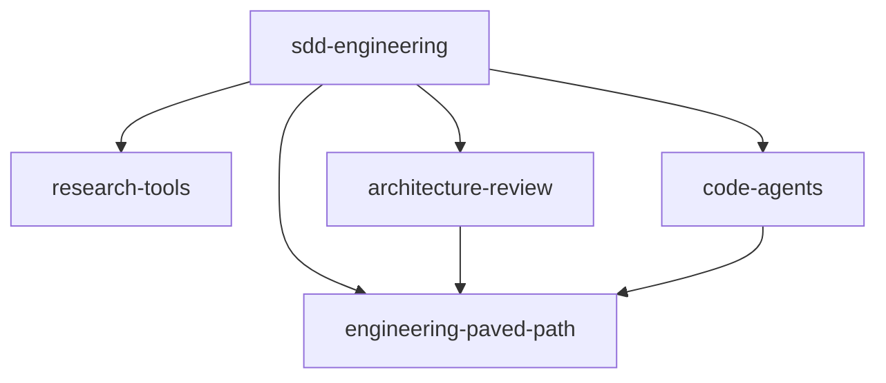

# devdigest-marketplace (stable channel)

This is the **stable channel** of the devdigest-marketplace: the `stable` branch, catalog name
`devdigest-marketplace-stable`, serving the verified release snapshot of the plugins. The
latest channel (branch `main`, catalog name `devdigest-marketplace`) carries newer releases.
Use one channel per project: both channels serve the same plugin names. The switch procedure,
the promotion rule and the rollback rule are in
[Release channels](https://github.com/xSneshx/devdigest-marketplace/blob/main/docs/RELEASES.md#release-channels).

A Claude Code plugin marketplace of project-agnostic, spec-driven engineering
plugins. Five versioned plugins, an object-form dependency graph, plugin-level guard hooks
and tagged releases.

## Catalog

| Plugin | What it ships | Depends on |
|---|---|---|
| `engineering-paved-path` | Paved-path engineering skills: React, Next.js, Fastify, layering, TypeScript, Zod, security, diagrams | none |
| `research-tools` | Read-only researcher agent | none |
| `architecture-review` | Architecture reviewer agent | `engineering-paved-path` |
| `code-agents` | Implementer and test-writer agents with guard hooks; usable without the spec workflow | `engineering-paved-path` |
| `sdd-engineering` | Spec, plan, run-plan, verify and retro agents, skills and commands | all four plugins above |

The catalog file is `.claude-plugin/marketplace.json`; each plugin lives in `plugins/<name>/`.
The plugin manifest is the single source of a plugin's version.

## Install

Add the marketplace once, then install what you need. Dependencies are installed and
enabled automatically.

```sh
claude plugin marketplace add xSneshx/devdigest-marketplace#stable
claude plugin install sdd-engineering@devdigest-marketplace-stable
```

Install a single plugin the same way, for example
`claude plugin install research-tools@devdigest-marketplace-stable`. Start a new session after
installing or updating so hooks, agents and skills are loaded.

## Dependency graph



Each edge is a manifest `dependencies` entry in object form with a version range. The
install-time dependency and the run-time `skills:` injection are two separate mechanisms;
see [docs/PLUGIN-GUIDELINES.md](docs/PLUGIN-GUIDELINES.md).

## Documentation

- [docs/PLUGIN-GUIDELINES.md](docs/PLUGIN-GUIDELINES.md): plugin structure, manifest fields, dependency rules, consumer inputs
- [docs/SECURITY.md](docs/SECURITY.md): permissions, guard model, secrets, hook and script review
- [docs/RELEASES.md](docs/RELEASES.md): SemVer, tags, update, rollback
- [CONTRIBUTING.md](CONTRIBUTING.md): how to change a plugin and test it locally
