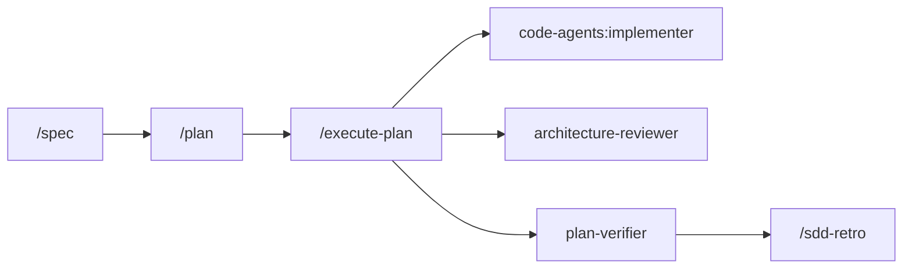

# sdd-engineering

## Use case

A spec-driven development workflow: write a spec, turn it into an implementation plan,
execute the plan with implementer agents and review gates, verify the result, and run a
retrospective. Installing it also installs the four plugins it builds on.

## Components

Commands (all prefixed `sdd-engineering:`):

| Command | Does |
|---|---|
| `/sdd-engineering:spec` | Hands a feature request to the `spec-creator` agent |
| `/sdd-engineering:plan` | Hands an approved spec to the `implementation-planner` agent |
| `/sdd-engineering:execute-plan` | Runs a plan through the `run-plan` skill |
| `/sdd-engineering:verify` | Hands a plan to the `plan-verifier` agent |
| `/sdd-engineering:sdd-retro` | Runs the `workflow-retro` skill (manual only) |

The execute command is `execute-plan`, not `run-plan`: a command and a skill with the same
name collide, and the command wins and hides the skill. The skill itself stays
`sdd-engineering:run-plan`.

Agents: `sdd-engineering:spec-creator`, `sdd-engineering:implementation-planner`,
`sdd-engineering:plan-verifier`.

Skills: `sdd-engineering:run-plan`, `sdd-engineering:workflow-retro` (with its
`scripts/analyze_journals.py`).

Hooks: a `PreToolUse` guard keyed on `agent_type` = `<plugin>:<agent>`. Guarded:
`sdd-engineering:spec-creator` (writes exactly one Markdown file directly under a spec
directory; never edits a spec whose status is approved or implemented) and
`sdd-engineering:plan-verifier` (read-only). Unguarded agents are never blocked.

Delivered by dependencies, not shipped here:

| Plugin | Provides |
|---|---|
| `engineering-paved-path` | the engineering skills the agents preload (cross-plugin `skills:` preload verified at gate G2; the Skill-tool fallback line stays for any skill not in context) |
| `research-tools` | `research-tools:researcher`, dispatched by the spec and plan authors |
| `architecture-review` | `architecture-review:architecture-reviewer`, a review gate in `run-plan` |
| `code-agents` | `code-agents:implementer` and `code-agents:test-writer`; `run-plan` dispatches the implementer |



## Requirements

- Claude Code (see `COMPATIBILITY.md`).
- Node.js >= 22 for the guard hooks (also required by `code-agents`).
- Python >= 3.7, standard library only, for the `workflow-retro` script. It is not
  auto-installed; without it the retro falls back to an in-context retro.
- Git.
- Dependencies, installed automatically: `engineering-paved-path`, `research-tools`,
  `architecture-review`, `code-agents` (each ^1.0.0, declared in object form; the marketplace
  resolves them to the versions in its current commit).


## Installation

Add the marketplace once, then install the plugin. Dependencies are installed and enabled
automatically. Start a new session afterwards so agents, skills and hooks are loaded.

```sh
claude plugin marketplace add xSneshx/devdigest-marketplace
claude plugin install sdd-engineering@devdigest-marketplace
```

The marketplace repository is private, and Claude Code clones it with git without a prompt.
Set up non-interactive git credentials first, with either:

- HTTPS: `gh auth setup-git` (after `gh auth login`), or any other git credential helper
  that holds a token with read access to the repository; or
- SSH: a prompt-free key (loaded in the agent, no passphrase prompt) with read access, then
  add the marketplace by its SSH URL: `claude plugin marketplace add git@github.com:xSneshx/devdigest-marketplace.git`.

Check access with `git ls-remote https://github.com/xSneshx/devdigest-marketplace.git` (or the
SSH URL). It must finish without asking for input.

## Troubleshooting

| Symptom | Cause and fix |
|---|---|
| Adding the marketplace or installing fails with a git authentication error, or hangs and then fails because git cannot ask for a username or password | The repository is private and the install runs git non-interactively. Set up credentials as described under Installation (`gh auth setup-git` or a prompt-free SSH key), confirm with `git ls-remote`, and retry. |
| The plugin is listed but shows a load error about an unsatisfied dependency version | Update the marketplace (`claude plugin marketplace update`), then run `claude plugin update <plugin>`. Dependency ranges are checked against the plugin versions in the marketplace's current commit. |
| Agents, skills or hooks do not appear after install | Start a new session; components are loaded at session start. Run `claude plugin list` to confirm the plugin is enabled. |

## Quick start

1. Install the plugin and start a new session.
2. `/sdd-engineering:spec add CSV export to the reports page`: produces a spec in the
   project's spec directory.
3. Review and approve the spec, then `/sdd-engineering:plan <path to the spec>`.
4. `/sdd-engineering:execute-plan <path to the plan>`: implementers run per the plan's task
   graph, then the architecture and verification gates run. The skill never commits, pushes or
   merges.
5. `/sdd-engineering:verify <path to the plan>` for a stand-alone check, and
   `/sdd-engineering:sdd-retro` afterwards if you want a retrospective.

Optional `.claude/project-inputs.json` in your project (all keys optional; an explicit value
wins over discovery, and agents state which value came from an explicit input):

| Key | Read by | Meaning |
|---|---|---|
| `specDirs` | spec-creator, spec guard | where specs are written (default: discovered `specs/` directories, else top-level `specs/`) |
| `ruleFiles` | spec-creator, implementation-planner, plan-verifier | rule and context files to read first |
| `planDir` | implementation-planner, spec-creator | where plans are written (default `docs/plans` when the caller gives none) |
| `checkCommands` | implementation-planner, plan-verifier (and the read-only guard) | check commands to plan with and to run; replace discovery |
| `testLocations` | implementation-planner, plan-verifier | where tests live |
| `protectedPaths` | implementation-planner | never planned as a task's owned paths |
| `retroLedger` | workflow-retro | retro ledger file (default `docs/sdd-retros/ledger.md`) |

The retro ledger path is resolved as: the skill's `ledger:<path>` input, then `retroLedger`, then `docs/sdd-retros/ledger.md` (relative to the project root, created with a header if missing); `no-ledger` skips it.
A malformed `project-inputs.json` is a guard evaluation failure: the guarded agents are
denied until it is fixed.

## Decoupling

The agents and skills were generalized from a source project so that they reference none of
its paths, packages, tools or port numbers (AC-12). Each source-specific input became a
generic rule or an explicit input.

### spec-creator

| Source reference | Replacement | Kind |
|---|---|---|
| Four read-only product MCP tools in `tools:` | Removed. A project-specific read-only MCP server is optional context; when absent the agent records an open question and continues (AC-13) | rule |
| Unprefixed researcher entry (with Explore) in the Agent tool list | `Agent(research-tools:researcher, Explore)` (AC-15) | namespaced reference |
| Bare skill names in `skills:` | `engineering-paved-path:<skill>` plus a line telling the agent to load a skill by its namespaced name with the Skill tool if it is not in context (AC-15, AC-36) | namespaced reference |
| Lessons-learned skill in `skills:` | Dropped; lessons-learned notes are read through discovery when the project keeps any | removed |
| Frontmatter `hooks:` calling a repo guard script | Removed. The plugin-level `specs` guard profile enforces the limit (AC-24) | removed |
| Per-module `specs/` table naming product packages | `specDirs` input, then discovery of `specs/` directories, then a top-level `specs/` default; the output states which was used (AC-14, AC-69, AC-70) | explicit input / discovery |
| Hard-coded rule files, module docs and notes for named packages | `.claude/project-inputs.json` (`ruleFiles`, `specDirs`, `planDir`) first, then discovery of `CLAUDE.md`, `AGENTS.md`, `README.md`, `docs/`, specs and lessons-learned notes | explicit input / discovery |
| Review-engine invariants of the product | Generic rule: respect any invariants the project's rule files state and capture them under Untrusted inputs / Non-functional | generic rule |
| Product examples in prose | Neutral wording | generic wording |
| Hook file name in the hard rules | "the plugin guard (`specs` profile)" | generic wording |
| Spec template | Kept section for section | unchanged |

### implementation-planner and plan-verifier

| Source reference | Replacement |
|---|---|
| Fixed package map and per-package commands | Discovered project map: areas, check commands, test locations, rule files (AC-69) |
| Hard-coded plan directory | Caller-supplied directory, or `planDir`, default `docs/plans` (AC-70) |
| Path-to-skill routing file and table | Assign `engineering-paved-path:*` skills by file type found in the project |
| "Repo facts plans get wrong" section | Dropped; discovery plus the project's rule files replace it |
| Unprefixed skills in `skills:` | Namespaced `engineering-paved-path:*` plus a Skill-tool fallback line (AC-36) |
| Unprefixed researcher entry (with Explore) in the Agent tool list | `Agent(research-tools:researcher, Explore)` |
| Project-specific insights paths and skill | Generic "insights or lessons file the project keeps" |
| `hooks:` frontmatter on the verifier (ignored for plugin agents) | Removed (AC-14); read-only is enforced by `disallowedTools` and the plugin-level guard |
| Fixed verifier command whitelist | Only commands the project map shows; a missing check is reported as "not defined" (AC-69) |
| Attribution footer | Dropped |

Kept on purpose: all plan headings and task fields (the contract with `run-plan` and the
verifier), the `grep -rn ... | wc -l` rule for negative checks, the spec gate, the single
execution-mode question, and the DAG and non-overlapping `Owned paths` rules.

### run-plan and workflow-retro skills

| Source reference | Replacement |
|---|---|
| `run-plan`: product name in the description, a self-review skill, a git-format reference, a fixed diff base, a "no test-writer" rule, UI and curl smoke specifics, model notes | Removed or generalized; the changed set comes from `git status` / `git diff` with no assumed base branch; commits ask first and follow the project's convention |
| `run-plan`: unprefixed agents | `code-agents:implementer`, `architecture-review:architecture-reviewer`, `sdd-engineering:plan-verifier` (AC-12, AC-63) |
| `run-plan`: no overlap check | New step 0b: refuses to dispatch in parallel mode when owned paths overlap (AC-64) |
| `run-plan`: may start a retro | Never invokes `workflow-retro` or `/sdd-engineering:sdd-retro` (AC-65) |
| `workflow-retro`: fixed ledger path | `ledger:<path>` input, default `docs/sdd-retros/ledger.md` relative to the consumer project (AC-17); `no-ledger` prints the report only |
| `workflow-retro`: script path | `python3 "${CLAUDE_SKILL_DIR}/scripts/analyze_journals.py"` (AC-16) |
| `analyze_journals.py`: no interpreter check, `/` path split, absolute home paths | Python >= 3.7 check with a clear message (AC-46), `os.path.basename`, no home paths; per-message-id de-duplication of usage lines kept |
| `workflow-retro`: auto-invocable | `disable-model-invocation: true` kept (AC-65); `/sdd-engineering:sdd-retro` is manual only |

## Verification

```sh
claude plugin validate sdd-engineering --strict
claude plugin details sdd-engineering   # 3 agents, 2 skills, 5 commands; dependency agents and skills
python3 --version                       # 3.7 or newer, for /sdd-engineering:sdd-retro
node --version                          # v22 or newer, for the guards
```

To run the retro script from the installed location, see the skill's usage section; it uses
`${CLAUDE_SKILL_DIR}`. Eval cases (positive, negative, workflow) are under `evals/`.

## Support


Open an issue in the `xSneshx/devdigest-marketplace` repository. Include the plugin name and
version (`claude plugin list`), the Claude Code version (`claude --version`) and the smallest
prompt that reproduces the problem. Do not paste tokens or private code into an issue.
Contribution and local-testing steps are in the repository's `CONTRIBUTING.md`.
